<a href="https://nicolegesareonyiego.vercel.app/"></a>

 


<a href="https://github.com/Gesare-n/kilimo-360-smart-irrigation"></a>
<a href="https://github.com/Gesare-n/agv-project"></a>
<a href="https://github.com/Gesare-n/IoT-Data-Ingestion-Microservice"></a>

<a href="https://github.com/Gesare-n/ev-charging-optimization-ml"></a>
<a href="https://github.com/Gesare-n/aviation-safety-analysis"></a>

<a href="https://github.com/Gesare-n/genai-linkedin-post-generator"></a>

<a href="https://github.com/Gesare-n/IoT-Data-Ingestion-Microservice"></a>
<a href="https://github.com/Gesare-n/kilimo-360-smart-irrigation"></a>

<a href="https://github.com/Gesare-n/space-shooter-3d"></a>
<a href="https://github.com/Gesare-n/Merge-Mini-Game"></a>
<a href="https://github.com/Gesare-n/skyglide-adventure-2"></a>
<a href="https://n-gesare-o.itch.io"></a>

<a href="https://github.com/Gesare-n/forest-pulse"></a>
<a href="https://github.com/Gesare-n/pesasmart"></a>
<a href="https://nicolegesareonyiego.vercel.app/"></a>
<a href="https://github.com/Gesare-n/afroarthub-marketplace"></a>



 


↑ ↑ ↓ ↓ ← → ← → B A

 
You found the secret level. Before I wrote code I was (and still am) a traditional artist, so this page is laid out like one of my engineering drawings. Message me on <a href="https://www.linkedin.com/in/nicole-gesare-onyiego-06a2a4265/">LinkedIn</a> with the word <b>respawn</b>.

